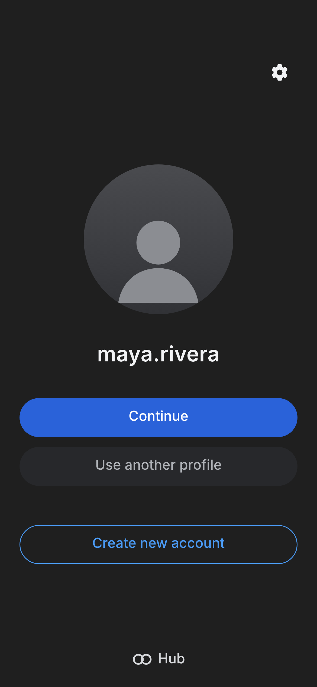
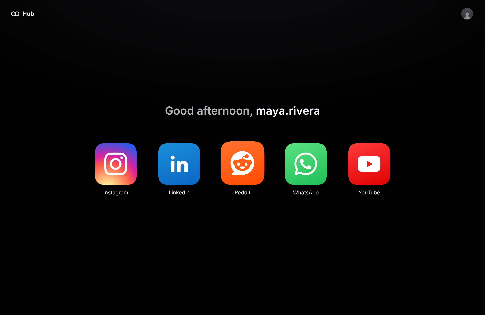
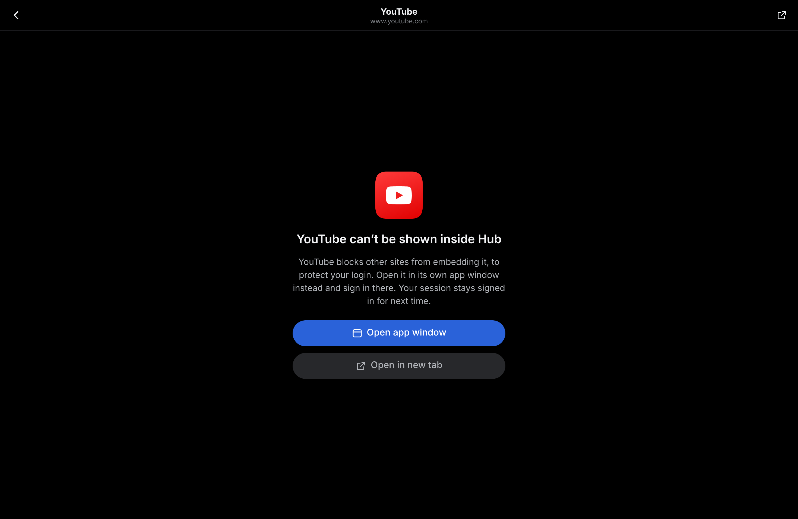

# Hub: social aggregator (v1)

A responsive, installable PWA that launches the social sites you use every day
(Instagram, LinkedIn, Reddit, WhatsApp and YouTube) from one obsidian-black
home screen of squircle icons, behind its own email and password login.

| Login | Home | In-app view |
| --- | --- | --- |
|  |  |  |

## Run it

```bash
npm install
npm run dev        # http://localhost:5173
npm run build      # type-checks, builds, and generates the service worker
npm run preview    # serve the production build (PWA install works here)
```

To install: open the preview/production URL in Chrome or Edge and use
**Install app** in the address bar, or in Safari on iPhone/iPad use
**Share → Add to Home Screen**.

## What's in v1

- **Login screen** modelled on the reference design: gear (profiles on this
  device), large circular profile photo, username, blue **Continue**, grey
  **Use another profile**, outlined **Create new account**, footer wordmark.
- **Email and password accounts.** `LocalAuthService` stores accounts in this
  browser only; passwords are salted and hashed with PBKDF2-SHA256 (Web
  Crypto, 210k iterations). The UI talks only to the `AuthService` interface
  in `src/auth/types.ts`, so a server-backed implementation can be passed to
  `<AuthProvider service={...}>` later without UI changes.
- **Home screen**: black background, superellipse (squircle) tiles via an SVG
  `clipPath`, responsive grid (4 columns on phones, 5 on tablets and laptops,
  128px tiles at MacBook Air 13.6" size), safe-area insets, 44px+ touch
  targets.
- **Launching**: tapping an icon asks **Open in app** or **Open in new tab**,
  with an optional "Always do this" per app (reset from the account menu).
  You sign in on each site itself; Hub never sees those passwords.

## Known limitation: in-app view

All five sites send `X-Frame-Options` / `Content-Security-Policy:
frame-ancestors` headers that forbid embedding in another site's iframe. A
web app cannot override that. So "Open in app" shows an in-app screen that
offers a dedicated **app window** (a sized popup, which behaves like its own
window on desktop and in the installed PWA) or a new tab. Each app's
`frameable` flag in `src/apps/registry.ts` switches it to a real iframe for any
future site that allows embedding. True embedded browsing would need a native
shell (e.g. Capacitor or Tauri webviews) in a later version.

## Project layout

```
src/
  auth/        AuthService interface, LocalAuthService, React context
  apps/        app registry (name, URL, tile, glyph) and launch helpers
  components/  Squircle clip path, AppIcon, LaunchSheet, InAppView, Sheet
  screens/     Login, Home
scripts/make-icons.mjs   renders public/favicon.svg to PWA PNG icons
```

## Next versions

Feed, notifications and unread badges. `AppIcon` already accepts a `badge`
count, and the registry is the place to hang per-app data sources once there
is a backend to hold API tokens.

Brand glyphs come from [Simple Icons](https://simpleicons.org) (CC0); the
trademarks belong to their owners.
